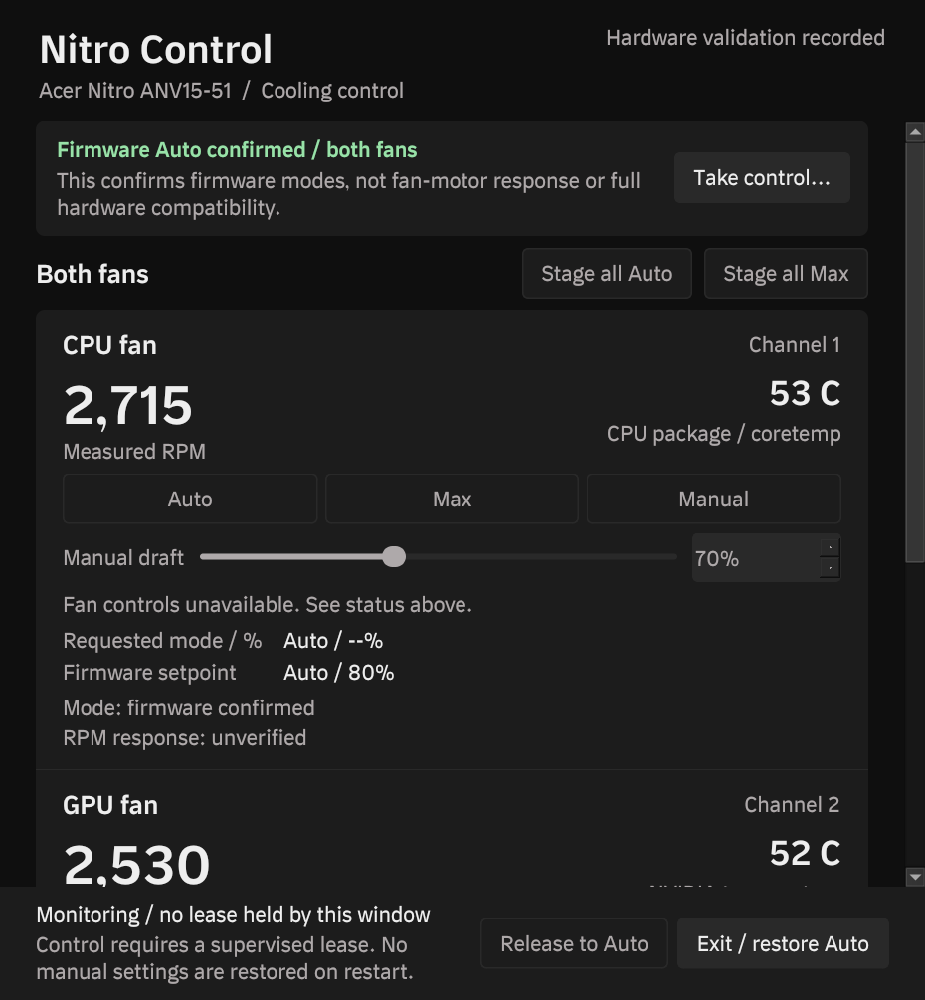

# Nitro Control

Fan control for the Acer Nitro ANV15-51 on Linux. Independent CPU and GPU fan
modes (firmware Auto, full-speed Max, Manual), real tachometer and temperature
telemetry, and supervised recovery to firmware Auto. Userspace only: it drives
the Acer hwmon interface exposed by a small in-tree acer-wmi quirk backport.
No embedded-controller access, no fan-control DKMS module, no unsupported
capability masks.



## Supported hardware

One exact configuration was verified on real hardware:

| Item | Value |
| --- | --- |
| Laptop | Acer Nitro ANV15-51 |
| Board (`board_name`) | `Sportage_RTH` |
| BIOS | V1.60 |
| Kernel | Linux `7.2.9-arch1-1-nitro-test` (Arch `7.2.9.arch1-1` stock config + quirk patch) |
| GPU driver | NVIDIA 615.78.08 (prebuilt modules for the test kernel) |
| Distribution | Arch Linux / Omarchy (Hyprland, Wayland) |

The userspace write gate matches all four DMI fields and refuses everything
else. A different Nitro model, board, BIOS revision, or similar fan layout is
not supported for writes, whether or not the kernel quirk matches it.

The kernel part is a 16-line upstream-derived DMI quirk added to
`drivers/platform/x86/acer-wmi.c` (see `packaging/0001-acer-wmi-anv15-51.patch`
and [docs/SOURCE-PROVENANCE.md](docs/SOURCE-PROVENANCE.md)). Without it the
driver does not bind a hwmon device on this model.

## Features

- Independent CPU/GPU channels: firmware Auto (`pwmN_enable=2`), full-speed
  Max (`0` — the firmware's fan mode, not a stop), Manual (`1`) with 50–100 %
  software-limited setpoints quantized to firmware percentages.
- Measured fan RPM (`fan1_input`/`fan2_input`), CPU package temperature
  (`coretemp`), and NVIDIA GPU temperature read through NVML by a persistent
  nonblocking helper (slow `nvidia-smi` never blocks or hides CPU data).
- Requested mode, firmware-reported setpoint/mode and measured RPM are kept
  separate everywhere; missing or stale values are shown as unavailable,
  never as zero or interpolated.
- Explicit Apply; drafts are staged per channel and only applied on command.
- Root supervisor with a five-second identity-bound lease, 1 Hz heartbeat,
  completed-loop watchdog, and independent post-stop/crash/suspend recovery
  to firmware Auto. No manual settings are replayed after restart or resume.
- polkit-gated control (`org.nitrocontrol.control`); the GUI runs
  unprivileged, read-only by default, and never runs as root.

## Architecture

```
application/nitro_control/   Python package: GUI (PySide6), controller worker,
                             supervisor, recovery, hardware adapter, telemetry,
                             NVML helper, deployment CLI
application/tests/           offline unit tests (211)
bin/nitro-control            entry-point launcher (source tree and installed)
data/                        systemd units, polkit policy, desktop entry, icon
packaging/                   kernel recipe (PKGBUILD, config, quirk patch, PGP keys)
packaging/application/       deterministic application package recipe
scripts/                     guarded build/pipeline/deployment tooling + tests
docs/                        runbooks: install, deployment, rollback, acceptance
evidence/hardware/           raw real-hardware test evidence
```

Details in [docs/ARCHITECTURE.md](docs/ARCHITECTURE.md); the IPC contract is
[application/PROTOCOL.md](application/PROTOCOL.md).

## Building

The test kernel is built as a separate Arch package, leaving the stock kernel,
UKI and boot configuration untouched:

```sh
bash scripts/build-kernel.sh --preflight   # dependency/space checks
bash scripts/build-kernel.sh --build       # full build under resource guard
```

The application package is deterministic and built from a source bundle:

```sh
python3 scripts/build-application.py
```

Both require the ordinary user, not root; `scripts/resource-guard.py` enforces
disk/memory/timeout limits during compilation. Full procedure, package audits
and hook masking: [docs/INSTALL-ROLLBACK.md](docs/INSTALL-ROLLBACK.md) and
[docs/NVIDIA-UKI.md](docs/NVIDIA-UKI.md).

## Installation and usage

The audited, hash-pinned deployment path installs the two kernel packages,
imports prebuilt NVIDIA modules for the new release only, backs up the ESP
off-ESP, and stages the UKI and a separate Limine entry:

```sh
python3 scripts/create-deployment-plan.py --output plan/deployment.json
nitro-control-deploy --manifest plan/deployment.json --preflight
nitro-control-deploy --manifest plan/deployment.json --manifest-sha256 <digest> --apply
```

Then boot the `linux-nitro-test` entry once, and enable the backend:

```sh
sudo systemctl enable --now nitro-control.service
nitro-control
```

See [docs/APPLICATION-INSTALL.md](docs/APPLICATION-INSTALL.md) for source-tree
usage, application packaging, service wiring and activation details.

## Safety and recovery

- Only the supported Acer hwmon interface is used, discovered under the real
  `acer-wmi` platform device with exact DMI/BIOS matching.
- Firmware Auto is established before any manual session; the supervisor
  attempts Auto for both fans on lease expiry, worker death, stop, fault and
  suspend, and verifies both readbacks — a partial reset is a visible fault.
- Control requires the root-protected `/etc/nitro-control/hardware-approved`
  marker and a reviewed acceptance record (`hardware-verified.json`);
  otherwise only attended validation mode writes, and nothing writes at all
  by default.
- The GUI shows connected/read-only/unsupported/recovery states with causes;
  Exit/restore Auto is always available.
- Boot rollback: the stock UKI and Limine default entry are never modified;
  removal of the test kernel, its entry and its NVIDIA target is a targeted,
  separately audited operation. See [docs/DEPLOYMENT.md](docs/DEPLOYMENT.md).

## Known limitations

- Secure Boot must remain disabled. The UKI kernel and NVIDIA modules are
  signed with a build-time autogenerated kernel key; nothing enrolls keys.
- Verified on one machine/config only; other Acer models are not supported
  for writes and no claim is made for them.
- The test kernel tracks the stock `7.2.9.arch1-1` config; treat it as a
  pin, not a long-term branch. Revalidate after kernel/driver updates; retire
  the backport once an official kernel includes the quirk.
- Manual floor 50 % is a software safety policy, not a calibrated hardware
  minimum; RPM changes are observations, not proof of causality.
- Controller-loop hang, telemetry invalidation and partial-write faults were
  verified by unit tests, not injected against real firmware.
- Zero RPM at a cool idle (~45 °C) is normal firmware-Auto behavior here.

## Licensing

- Application, helpers, build tooling and docs: GPL-3.0-or-later.
- Kernel backport and the Acer driver source it modifies: GPL-2.0-or-later.
- Arch packaging recipe and stock configuration: 0BSD.

Full texts in [LICENSE](LICENSE) and [LICENSES/](LICENSES/); scope and
attribution in [NOTICE.md](NOTICE.md). NVIDIA module binaries carry their own
license inside the validated DKMS archive and are not redistributed.
