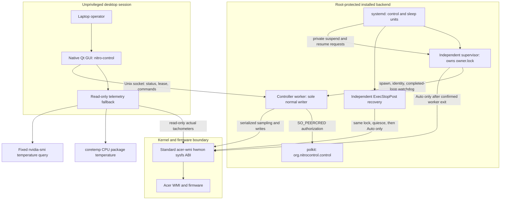
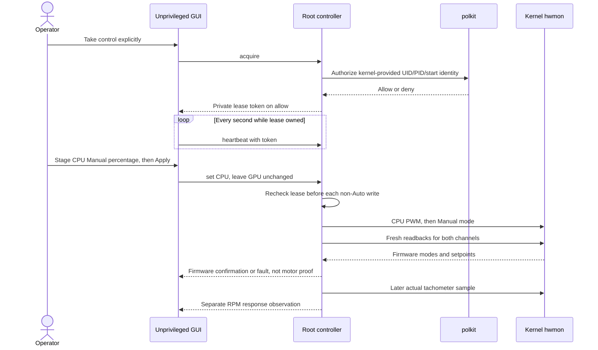
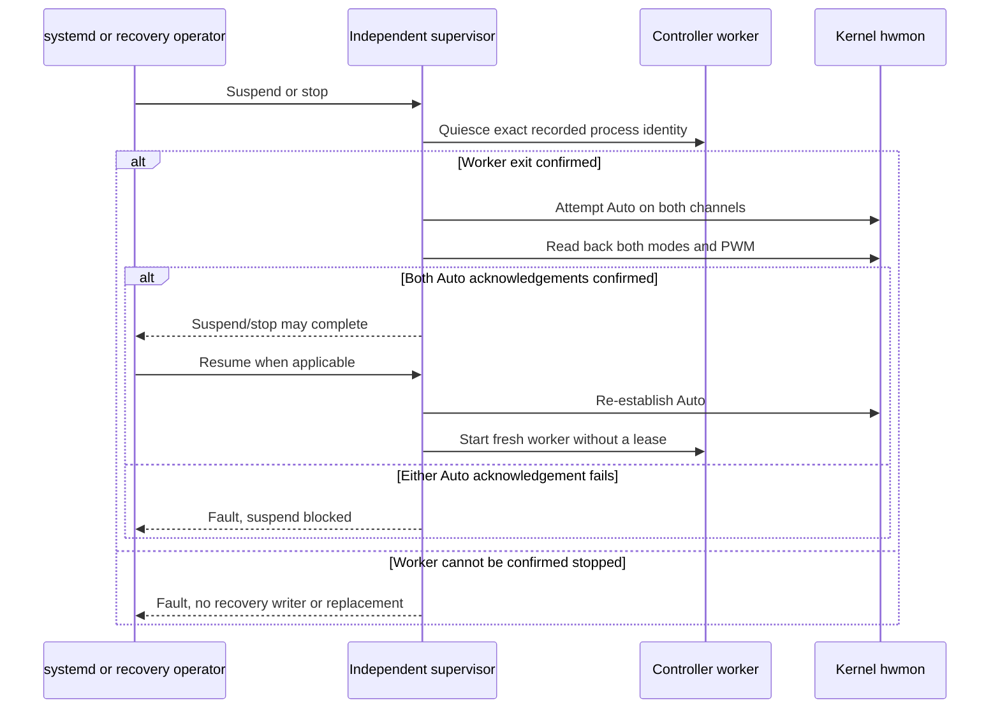

# Architecture

Nitro Control is a separate Python userspace application with a native PySide6
GUI and a narrowly scoped root backend. The kernel change is only a 16-line
model quirk. Backend/GUI behavior is implemented, software-tested, and verified
on real ANV15-51 hardware (see [HARDWARE-ACCEPTANCE.md](HARDWARE-ACCEPTANCE.md)).
Service wiring below is the deployment contract to check against the packaged
units. None of this is a firmware guarantee.

## Privilege And Processes

The GUI runs as the desktop user, never automatically as root. Without a
trusted controller it monitors locally without writing even Auto. CPU package
temperature comes from `coretemp`; GPU temperature comes only from the fixed
`/usr/bin/nvidia-smi` query, not a CPU fallback. Actual tachometers alone supply
RPM. Missing, failed, or stale data is unavailable, not zero or percent-as-RPM.

The supervisor alone holds the singleton lock in root-owned
`/run/nitro-control` (0755). The worker is the sole normal writer. Supervisor
and post-stop recovery may write only after the exact worker's exit is
established; an unknown identity or unkillable worker blocks their recovery
writes and replacement workers. The independent post-stop helper must acquire
the same lock, never bypass it.

Installed Python code, interpreter, launchers, approval files, and their
ancestors must be root-protected, non-symlink where checked, and not
group/world writable. A root service must not import code from a user checkout,
editable install, user site, or user-controlled `PYTHONPATH`. No writable helper
or arbitrary client-supplied command/device path is accepted.

## Control Gates

Normal control requires all of the following:

- Effective UID zero and explicit `--enable-control`, with the fixed production runtime and protected installed code.
- Exact DMI/BIOS identity and the genuine single `name=acer` hwmon under the `acer-wmi` platform driver.
- Effective module parameters `predator_v4=N`, `force_caps=-1`, `ec_raw_mode=N`, and the required interfaces.
- A trusted root-owned regular `/etc/nitro-control/hardware-approved` marker; this is operator permission, not hardware evidence.
- Either a reviewed `/etc/nitro-control/hardware-verified.json` record for this exact identity/running kernel, or explicit `--validation-mode` for the initial unverified trial.

Common identity, trust, approval, and enablement gates also apply to Auto
recovery. A missing fan interface must not suppress an otherwise authorized
Auto attempt on the remaining channel; inability to confirm both is a fault.

An empty approval marker alone is not acceptance: without a reviewed record,
it permits validation only with that flag, never ordinary verified operation.
The acceptance record requires integer `schema=1`, boolean
`accepted=true`, exact `identity`, exact `kernel_release`, and a nonempty
`evidence` reference. Neither code nor tests create approval or acceptance
files. See [APPLICATION-INSTALL.md](APPLICATION-INSTALL.md) for activation.

## Lease And Commands

The version-1 newline JSON protocol is defined in
[PROTOCOL.md](../application/PROTOCOL.md); implementation details and entry
points are in [BACKEND.md](../application/BACKEND.md). The public socket is
`/run/nitro-control/control.sock`; status access grants no control.

The lease expires after five seconds without heartbeat and is bound to
`SO_PEERCRED` UID/PID plus process start identity, not client-provided identity.
GUI heartbeats run every second independently of slow requests. Neither status,
heartbeat, nor authorization threads feed the separate five-second
**completed-controller-loop** watchdog. Tokens are not persisted or disclosed
in status, events, or recovery state. Missing/denied polkit fails closed.

| Request | `pwmN_enable` | Setpoint |
| --- | --- | --- |
| Auto | `2` | Firmware-controlled, no invented target |
| Max | `0` | Firmware full speed, not fan stop or PWM zero |
| Manual | `1` | Separate `pwmN`, raw 0..255, quantized to firmware integer percent |

CPU is channel 1; the GPU-side fan is channel 2. Manual accepts integer
50..100 percent, with PWM written before Manual mode. The 50% floor is a
software policy, **not a calibrated motor limit**. Matching mode/setpoint is
`firmware-confirmed`, not hardware verification. An observed RPM change is
reported separately and does not prove causality or a calibrated maximum.

## Faults And Sleep

Lease loss, client death, controller failure, partial writes/readbacks, and
externally changed firmware state trigger Auto recovery attempts. While Manual
is active, stale/missing temperatures or tachometers, CPU at least 85 C, or GPU
at least 80 C cancel ownership. Both Auto writes are attempted before both
readbacks; a partial reset remains a fault. No Manual state is replayed after
restart, resume, lease expiry, or a software fault. Re-arming is explicit.

`nitro-control.service` uses independent `ExecStopPost` recovery and preserves
runtime evidence across stop. `nitro-control-sleep.service` is required by and
ordered before `sleep.target`: its start requests suspend/quiescence/Auto, and
its stop requests resume. With that hook correctly enabled, inability to
confirm quiescence and both Auto acknowledgements must fail the required sleep
job, blocking suspend. Do not ignore the error or downgrade the requirement.
Actual service/failure/suspend behavior on this laptop was exercised during
the hardware acceptance (see [HARDWARE-ACCEPTANCE.md](HARDWARE-ACCEPTANCE.md));
fault-injection cases remain software-verified only.

`/run/nitro-control/recovery.json` exposes token-free recovery state and faults.
A fault is not cleared by pretending the disconnected GUI is in Auto. A wedged
kernel/WMI call, including a recovery call, cannot be guaranteed cancellable by
userspace. Stop the workload and escalate if safe exit/Auto cannot be proven;
do not race another writer or assume unload/reboot resets the fans.

The older kernel runbooks describe historical stages. Their statements that
the userspace helper is not implemented no longer describe this source tree;
their hardware acceptance cautions still apply. Current compatibility and
evidence limits are in [SUPPORTED-HARDWARE.md](SUPPORTED-HARDWARE.md).
